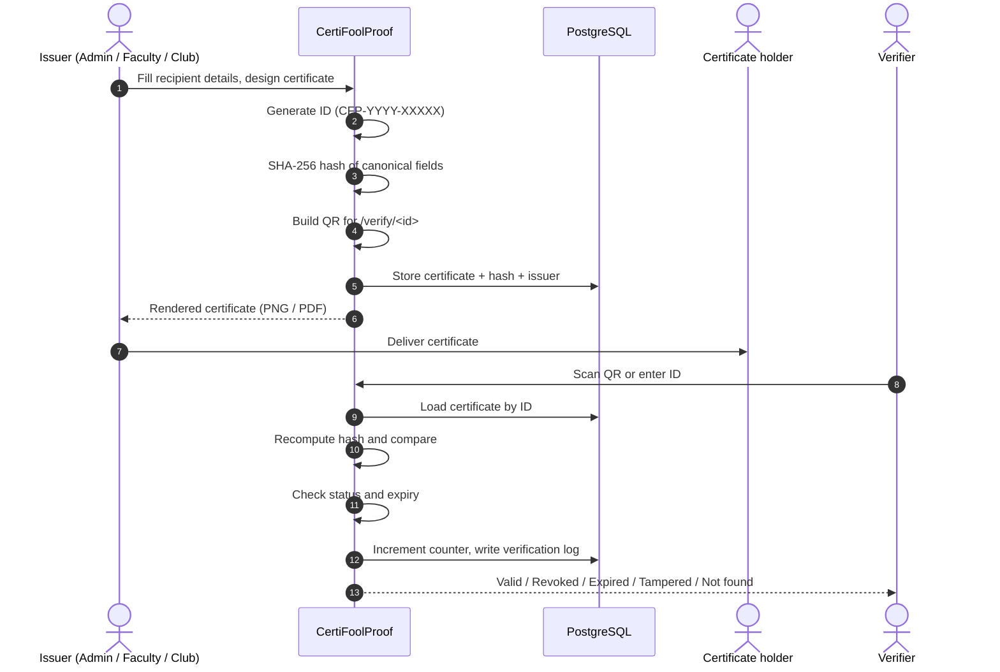
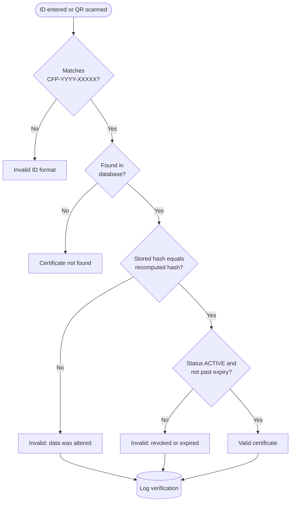
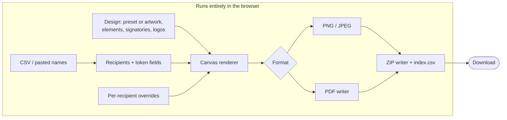
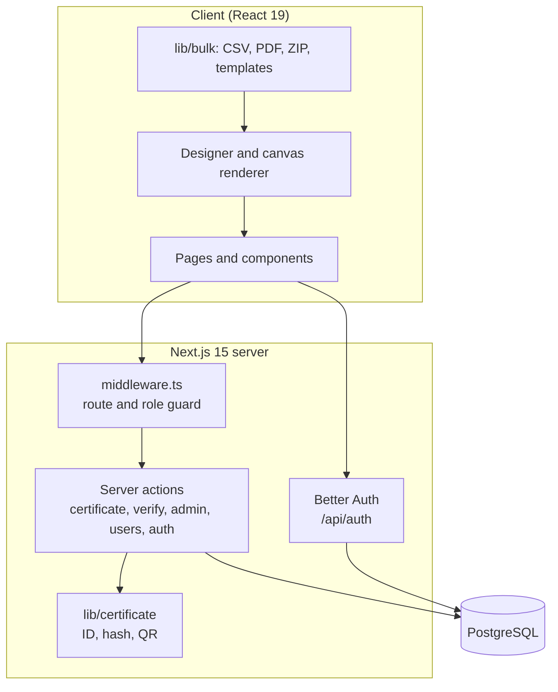
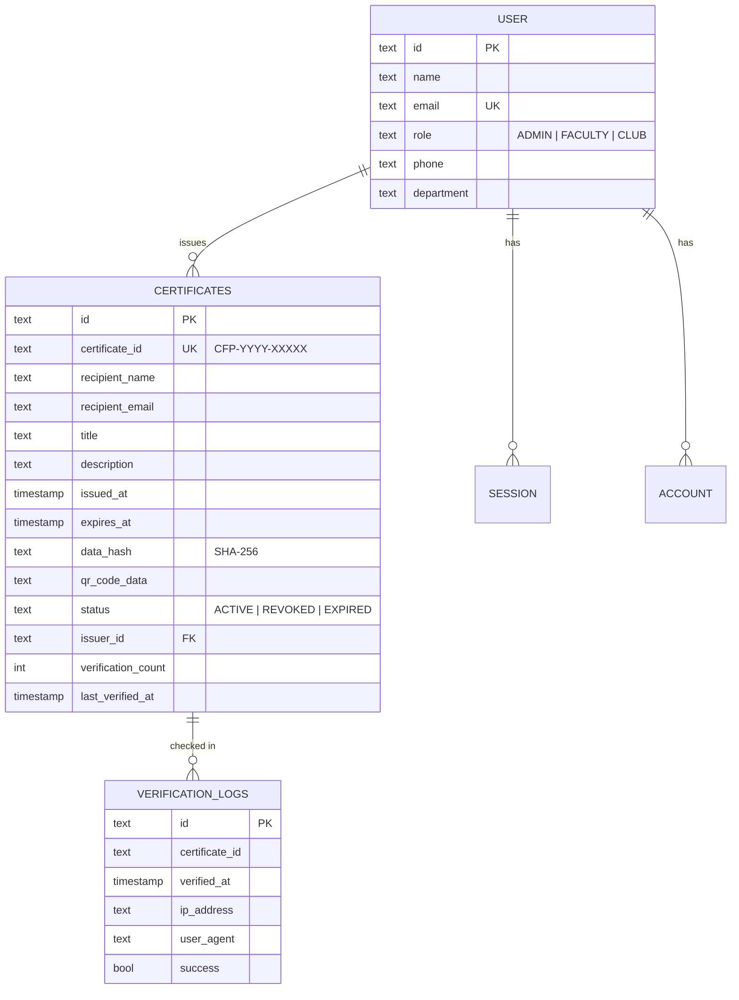

# CertiFoolProof

**Issue certificates that can be verified in seconds and cannot be faked.**

CertiFoolProof is a certificate issuing and verification platform for institutions, faculty and student clubs. Every issued certificate receives a unique ID, a SHA-256 integrity hash and a QR code that resolves to a public verification page. A separate, account-free bulk generator produces certificates for hundreds of participants entirely in the browser.


---

## Table of contents

- [Features](#features)
- [How it works](#how-it-works)
- [Architecture](#architecture)
- [Tech stack](#tech-stack)
- [Getting started](#getting-started)
- [Configuration](#configuration)
- [Usage guide](#usage-guide)
- [Data model](#data-model)
- [Security model](#security-model)
- [Project structure](#project-structure)
- [Scripts](#scripts)
- [Contributing](#contributing)
- [License](#license)

---

## Features

### Certificate issuance (authenticated)

| Capability | Details |
| --- | --- |
| Unique certificate IDs | Cryptographically random, format `CFP-YYYY-XXXXX` (year + 5 alphanumerics) |
| Tamper detection | SHA-256 hash over the canonical certificate fields, stored at issue time and recomputed on every verification |
| QR verification block | QR code plus the certificate ID, placed on the design as a movable, resizable element |
| Optional expiry | Certificates can carry an expiry date; expired certificates report as `EXPIRED` |
| Designer with live preview | The same editor as the bulk generator, with `{name}`, `{title}`, `{description}`, `{email}`, `{id}`, `{date}` and `{url}` placeholders |
| Export | PNG or print-ready PDF at true paper size |
| Issuer history | "My Certificates" lists the latest 50 certificates issued by the signed-in user |

### Bulk certificate generator (public, no sign-up)

Available at `/generate/bulk`. **Nothing is uploaded**: participant lists, artwork and signatures never leave the browser.

- **Participants**: CSV upload (delimiter auto-detected: `,` `;` `Tab` `|`, UTF-8 BOM handled) or paste one name per line. The name column is detected automatically. Up to 5,000 certificates per batch. A sample CSV can be downloaded.
- **Design**: three built-in presets (Classic, Neo, Minimal), or your own background artwork (PNG/JPEG/WebP, up to 10 MB). Page sizes: A4 landscape/portrait, US Letter landscape, 16:9 widescreen or square.
- **Element-level editor**: every text line (participant name, organization, heading, line above name, body, date, date label, signatory name, signatory title) is an independent element. Click it on the preview to drag, resize or restyle it: font, weight, size, colour, alignment, opacity, and text fit (`shrink`, `wrap`, `wrap + shrink`).
- **Layout tools** (above the live preview, on both the bulk and issuing pages): drag the side handles of a wrapping text box to set its width; the body stops after 3 lines by default, which can be raised up to 12 or lifted with *No line limit*. Arrow keys nudge the selection (`Shift` = 10x), and dragging snaps to the page centre, page edges and other elements (hold `Ctrl` to skip) with an optional grid overlay. `Shift`-click selects several items for align (left / centre / right / top / middle / bottom) and equal spacing (three or more). Each item can be locked, hidden, duplicated (logos and signatories), deleted, brought forward / sent back, or reset to its default position. `Ctrl+Z` / `Ctrl+Shift+Z` undo and redo. Locks, hiding and stacking order are saved with the template.
- **Token placeholders**: any text may contain `{name}`, `{index}` or any CSV column, e.g. `{course}`. Matching is case- and punctuation-insensitive. Unknown tokens stay visible in the preview instead of printing blank.
- **Signatories**: any number of signatories, each with a signature that is uploaded (with optional white-background removal), drawn on a pad, or typed in a script font (Dancing Script, Great Vibes, Caveat, Brush Script). Auto or free arrangement.
- **Logos**: multiple logos with position, size and corner-radius controls.
- **Per-recipient overrides**: change the wording of any element, or nudge and scale the name, for a single participant without touching the design. One click jumps to the longest name to check the worst case.
- **Export**: PNG, JPEG (quality slider) or PDF (lossless, high or compact). PDFs can be one combined file or one per participant. Everything is bundled as a ZIP with an `index.csv`. File names follow a pattern such as `{name}` or `{course} - {name}`, sanitised for Windows/macOS/Linux and de-duplicated.
- **Templates and autosave**: save the whole design as JSON (with artwork embedded) and load it back; validated and clamped on load. Work is autosaved to browser storage.

### Public verification

- Verify by ID at `/verify` or by scanning the QR code, which opens `/verify/<id>` directly.
- The result page shows recipient, title, issuer, issuer department, issue and expiry dates, status and how many times the certificate has been verified.
- Every check is logged (timestamp, IP address, user agent, outcome).

### Role-based access

| Role | Issue certificates | Dashboard | Admin panel |
| --- | :---: | :---: | :---: |
| Public | Bulk generator only | - | - |
| `CLUB` | Yes | Yes | - |
| `FACULTY` | Yes | Yes | - |
| `ADMIN` | Yes | Yes | Yes |

**Admin panel**: platform statistics (users by role, certificates, verifications, revocations, 6-month issuance chart), user management (create, change role, delete; admin accounts are protected), all certificates with one-click **revocation**, and the verification log.

---

## How it works

### Issue and verify lifecycle



### Verification decision



### Bulk generation pipeline



---

## Architecture



- **Server actions** handle all mutations and reads; each re-checks the session and role rather than trusting the route guard alone.
- **Middleware** protects `/admin`, `/generate` and `/dashboard`. The public routes are `/`, `/login`, `/signup`, `/verify`, `/verify/<id>` and `/generate/bulk`.
- **The designer is shared** between the issuing page and the bulk generator, so both render identically.
- **Certificate artwork is not stored on the server.** The database holds only certificate metadata and its hash; the issued design is rendered in the issuer's browser.

---

## Tech stack

| Layer | Technology |
| --- | --- |
| Framework | Next.js 15 (App Router, Turbopack), React 19, TypeScript 5 |
| Styling | Tailwind CSS 3, Lucide icons, next-themes |
| Auth | Better Auth (email and password), bcryptjs |
| Database | PostgreSQL via `postgres` driver and Drizzle ORM / Drizzle Kit |
| QR codes | `qrcode` (data URL, buffer and SVG output) |
| Bulk engine | Custom canvas renderer, PDF writer (JPEG/Flate) and ZIP writer (STORE), no third-party runtime dependencies |

---

## Getting started

### Prerequisites

- Node.js 20+ (or Bun)
- A PostgreSQL database

### Installation

```bash
git clone https://github.com/TimsTittus/CertiFoolProof.git
cd CertiFoolProof
npm install
cp .env.example .env      # then edit the values, see Configuration
npm run db:push           # create tables from db/schema.ts
npm run dev
```

The app is served at <http://localhost:3000>.

> **Note on the database connection:** [db/index.ts](db/index.ts) connects on port `6543` with SSL required (a pooled-connection setup such as Supabase's transaction pooler). Adjust it there if your PostgreSQL uses a different port or does not use SSL.

### First admin account

Sign up at `/signup`, choose the `ADMIN` role and enter the value of `ADMIN_PASSWORD`. Admins can then create Faculty and Club accounts from **Admin panel > Users**.

---

## Configuration

Copy [.env.example](.env.example) to `.env`.

| Variable | Required | Purpose |
| --- | :---: | --- |
| `DATABASE_URL` | Yes | PostgreSQL connection string |
| `DIRECT_URL` | - | Direct (non-pooled) connection string |
| `AUTH_SECRET` | Yes | Secret used for signing sessions |
| `AUTH_URL` | Yes | Public base URL; embedded in QR codes as `<AUTH_URL>/verify/<id>`. Defaults to `http://localhost:3000` |
| `NEXT_PUBLIC_APP_URL` | - | Base URL used by the browser auth client. Defaults to `http://localhost:3000` |
| `ADMIN_PASSWORD` | Yes | Secret key required to register as `ADMIN` |
| `FACULTY_PASSWORD` | Yes | Secret key required to register as `FACULTY` |
| `CLUB_PASSWORD` | Yes | Secret key required to register as `CLUB` |

> Set `AUTH_URL` to your production domain before issuing real certificates. It is baked into every QR code.

---

## Usage guide

### Issue a single certificate

1. Sign in and open **Issue Certificate** (`/generate`).
2. Enter the recipient name and email, title, optional description and optional expiry date.
3. Customise the design and add the **verification block** (QR code and ID).
4. Click **Issue**. The certificate is stored and rendered with its real ID and QR code.
5. Download it as **PNG** or **PDF**.

### Generate certificates in bulk

1. Open `/generate/bulk`. No account is needed.
2. **Design**: pick a preset or upload artwork, and choose a page size.
3. **Edit the text**: click elements on the preview and restyle them. Use tokens such as `{name}` or `{course}`.
4. **Signatories and logos**: add signatures (upload, draw or type) and logos.
5. **Add participants**: upload a CSV or paste names.
6. Preview any participant, apply per-recipient overrides if needed, then choose format, file-name pattern and **Generate**. You receive a ZIP.

Example CSV (any column becomes a token):

```csv
Name,Course,Grade
Aarav Nair,Data Structures,A
Meera Thomas,Machine Learning,A+
```

### Verify a certificate

Scan the QR code on the certificate, or go to `/verify` and enter the ID (`CFP-2026-AB12C`).

### Administer the platform

Sign in as an admin and open `/admin` for statistics, users, all certificates (with revoke) and verification logs.

---

## Data model



`session`, `account` and `verification` are managed by Better Auth. The schema lives in [db/schema.ts](db/schema.ts); migrations are generated into [drizzle/](drizzle/).

---

## Security model

- **Integrity**: the hash covers the certificate ID, normalised recipient name and email, title, issuer, issue and expiry timestamps and description. Any edit made directly in the database invalidates it.
- **Authorization**: enforced twice, in the middleware and again inside each server action. Admin-only actions call an `ADMIN` check before touching data.
- **Role registration**: each role requires its own secret key, so possessing a link is not enough to gain elevated access.
- **Password storage**: hashed with bcrypt.
- **Protected accounts**: admin accounts cannot be deleted or have their role changed through the UI.
- **Auditability**: every verification attempt is logged with IP, user agent and result.
- **Privacy in the bulk tool**: participant data is processed locally and never transmitted.
- **Revocation**: an admin can revoke a certificate at any time; it then fails verification immediately.

---

## Project structure

```text
app/
├── actions/            Server actions: certificate, verify, admin, users, auth
├── admin/              Admin panel: stats, users, certificates, logs
├── dashboard/          User dashboard and issued-certificate history
├── generate/           Certificate issuing page and shared designer
│   └── bulk/           Public bulk generator (editor panels, hooks, fonts)
├── verify/             Public verification (ID form and /verify/[id])
├── login/  signup/     Authentication pages
└── api/auth/           Better Auth route handler
lib/
├── auth.ts             Better Auth configuration
├── certificate/        ID generation, hashing, QR codes, verification block
├── bulk/               Renderer, CSV, tokens, templates, PDF, ZIP, images, export
└── enums.ts            UserRole, CertificateStatus
db/                     Drizzle client and schema
drizzle/                Generated SQL migrations
middleware.ts           Route protection and role guard
scripts/                Seed script
```

---

## Scripts

| Command | Description |
| --- | --- |
| `npm run dev` | Start the development server (Turbopack) |
| `npm run build` | Production build |
| `npm run start` | Serve the production build |
| `npm run lint` | Run ESLint |
| `npm run db:generate` | Generate a migration from schema changes |
| `npm run db:push` | Push the schema directly to the database |
| `npm run db:migrate` | Apply generated migrations |
| `npm run db:studio` | Open Drizzle Studio |
| `npm run db:seed` | Seed demo users (`scripts/seed.js`) |

---

## Contributing

Contributions are welcome. Please open an issue to discuss significant changes, keep pull requests focused, and run `npm run lint` and `npm run build` before submitting.

## License

Released under the [MIT License](LICENSE).
